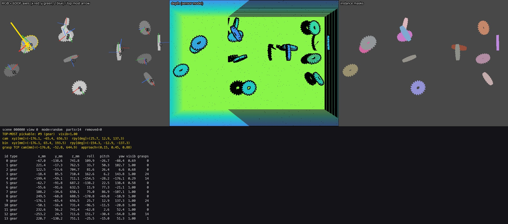

# binsim — synthetic bin-picking data (Isaac Lab)

Generates RGB-D images of parts dropped or stacked in a bin, with exact labels for training
**6D-pose**, **instance segmentation** and **grasp** models. Everything is set in a YAML
config, and many bins are rendered at once on the GPU.

For each settled bin it writes:
- RGB (or PhoXi-style grayscale), plus depth with a **structured-light sensor model** applied
  (range limits, projector shadows, dropouts at edges and grazing angles, depth-dependent noise)
- 6DOF pose of every part in camera and bin coordinates, full and visible masks, visible fraction
  (BOP format), and COCO instance masks
- grasp candidates checked for gripper collisions, and the **top-most pickable part**
- visual reports: a whole-scene overview, and an annotated bin image with 6DOF axes and the
  top-most part's grasp arrow, depth, masks and a per-part pose table



## Layout

```
configs/            default.yaml (experiment) + cameras/ robots/ parts/ presets
binsim/             library (simulator-independent except binsim/sim/)
  config.py         YAML + `defaults:` includes + dotted CLI overrides + validation
  assets.py         STEP/STL/OBJ -> mesh -> USD (pxr), cached by content hash
  loading.py        initial placement: random cluster / layers; shake schedule
  camera.py         intrinsics (with render_scale), viewpoint sampling
  noise.py          PhoXi-style depth artifacts
  grasps.py         grasp library (auto suction sampling / hand-defined jaw grasps), collision checks
  postprocess.py    raw renders -> BOP/COCO/grasps/poses/viz (runs on writer threads)
  viz.py, writers/  reports, BOP + COCO writers, async I/O
  sim/              Isaac Lab: scene.py, runner.py, randomize.py, compat.py (version shims)
scripts/            generate.py, launch_multi_gpu.py, prepare_assets.py, visualize.py, verify_poses.py
tests/              pytest (no Isaac needed; uses a CPU z-buffer renderer)
legacy/             the original single-camera capture script
```

## Install

On the Isaac machine, inside Isaac Lab's Python:

```bash
./isaaclab.sh -p -m pip install -r requirements.txt   # trimesh, pyyaml, opencv (faster masks)
./isaaclab.sh -p -m pip install cadquery              # only for STEP files (or: gmsh)
```

On a laptop (tests, asset prep, visualization only): `pip install -r requirements.txt usd-core`.

## Quick start

```bash
# 1. convert/cache CAD -> USD, check grasp sampling and the layer capacity
python scripts/prepare_assets.py --config configs/default.yaml

# 2. watch one bin fill + settle with the GUI
./isaaclab.sh -p scripts/generate.py --config configs/default.yaml --gui run.num_envs=1 run.num_scenes=2

# 3. check GT vs images (should print mean mask consistency ~0.98+)
python scripts/verify_poses.py ~/IsaacSim/captures/bin_ds/shard_00

# 4. production: all GPUs, 20k scenes, merged into one BOP dataset
python scripts/launch_multi_gpu.py --python "./isaaclab.sh -p" --total-scenes 20000 --merge run.num_envs=16
```

You can override any config value on the command line: `loading.mode=layers`,
`parts.0.count=[20,40]`, `camera.render_scale=1.0`, `sim.seed=3`, and so on.

## Config reference (configs/default.yaml)

| Section | What it controls |
|---|---|
| `defaults:` | camera preset (`cameras/phoxi_m`, `phoxi_l`, `generic_rgbd`) and robot+gripper preset (`robots/ur10_suction`, `ur10_2f85`) |
| `camera` | resolution, `render_scale`, intrinsics (`fx/fy/cx/cy` or `hfov_deg`), scan range, gray/rgb, mount (height above the rim, look-at, image-up), per-view pose jitter, `noise` sensor model |
| `robot` / `gripper` | robot USD (`{ISAACLAB_NUCLEUS_DIR}` placeholders allowed), base pose, parked joint pose; gripper type, optional visual USD, **collision primitives** used for grasp checks |
| `bin` | `mesh:` (your STEP/STL, needs `inner_size_m`) **or** a procedural box from `size_m` + `wall_thickness_m`; pose, friction, color |
| `parts` | a list of part types, each with `config: parts/<x>.yaml` and `count: [min, max]`. The part file holds the mesh path, units, mass, friction, collision approximation, color/roughness/metallic ranges, BOP symmetry, layer orientation, and grasps |
| `loading` | `mode: random / layers / mixed`, drop heights, layer grid (layers, spacing, jitter, fill ratio), **`shake`** (velocity kicks, optional bin wiggle), **`settle`** (velocity thresholds, max steps, escape margin) |
| `randomization` | dome and key light intensity and position, per-instance part and bin material jitter |
| `grasps` | min visibility, max approach angle, approach clearance, sampling density |
| `run` | `num_envs` (bins per GPU), `num_scenes`, `views_per_scene`, output dir, shard id, how often to save viz and overview images |
| `outputs` | bop / coco / pointcloud_ply / viz, `depth_scale`, `save_clean_depth` (noise-free depth alongside) |

Adding your own part: copy `configs/parts/gear_example.yaml` and set `mesh:` to your STEP/STL.
Set `units` (STEP is always read as mm), `symmetry` and `color`, then check the output of
`prepare_assets.py`. For a parallel-jaw gripper, list grasps under `grasps.parallel_jaw`
in the part frame.

## Output (per shard, BOP layout)

```
shard_00/
  camera.json  config_resolved.yaml  run_info.json
  models/obj_000001.ply, models_info.json          (mm, with symmetries)
  train_pbr/000000/
    rgb/000000.png   depth/000000.png (uint16 × depth_scale = mm, 0 = no data)
    mask/000000_000003.png  mask_visib/...          (per instance)
    scene_gt.json            cam_R_m2c, cam_t_m2c (mm), obj_id — per image, per instance
    scene_gt_info.json       bboxes, pixel counts, visib_fract
    scene_camera.json        cam_K, cam_R_w2c / cam_t_w2c (world = BIN frame, mm)
    scene_gt_coco.json       COCO instance segmentation (RLE)
    grasps/000000.json       grasps in camera frame: pose, width, approach angle, valid, reason; topmost_gt_idx
    poses/000000.csv         per-part 6DOF table (camera + bin frame, quat + rpy, visibility, #valid grasps)
  viz/overview_00000.jpg     whole scene (robot, bin, lights)
  viz/000000_00_bin.jpg      annotated bin view (axes, top-most arrow, depth, masks, pose table)
```

Pose convention (same as BOP / OpenCV): `p_cam = R · p_model + t`, camera x right, y down,
z forward, t in mm. Model frames are the CAD frames, recentered to the bounding-box center
(`recenter: true`).

## How the parallelism works

- **Within one GPU:** `run.num_envs` bins are cloned `env_spacing_m` apart and step together.
  Settling runs physics only (no rendering). A single `TiledCamera` then renders every bin's
  camera in one pass. Each settled pile is rendered from `views_per_scene` viewpoints, so the
  physics cost is shared across views.
- **Across GPUs / processes:** `launch_multi_gpu.py` starts one `generate.py` per GPU (or
  `--procs-per-gpu N`), each with its own `shard_id`. The shard id sets the seed and makes
  scene ids unique. `--merge` symlinks all shards into a single dataset.
- **CPU side:** writing PNGs, rasterizing masks, noise and grasp checks run on a thread pool
  (`run.writer_threads`) while the GPU works on the next batch.

The log prints scenes/s and images/s every `run.log_every_s`. Tune `num_envs` against it.
`camera.render_scale` has the biggest effect: 0.5 renders a quarter of the pixels.

## How realistic is the depth?

The legacy script saved the renderer's **perfect** depth, with no noise or holes.
`binsim/noise.py` applies what a structured-light scanner actually does. Every effect is
controlled under `camera.noise`:

- no data outside the scanning range (`depth_range_m`)
- **projector shadow**: surfaces the projector (offset by `projector.baseline_m`) can't
  illuminate get no depth. This is the dominant artifact beside tall parts and bin walls.
- dropouts on surfaces seen at grazing angles (`max_incidence_deg`)
- invalid pixels along depth discontinuities (`edge_*`), like PhoXi's flying-pixel filter
- axial noise ∝ z² (`sigma_mm_at_1m`), quantization, and random dropout

What it doesn't model: dropouts from specular or dark materials, multi-path interference
inside bins, and small calibration errors. The PhoXi intrinsics and baseline in the presets
are **approximate** values from the datasheet. Replace them with your calibrated `K` from
PhoXi Control, and compare a real scan against a simulated one of the same bin to tune
`sigma_mm_at_1m` and the edge settings. Set `outputs.save_clean_depth: true` to also keep
noise-free depth, for example for depth-completion targets.

## Verification & troubleshooting

- `pytest` runs without Isaac: config, placement, transforms, noise, RLE, grasp collisions,
  and an end-to-end scene rendered by a CPU z-buffer and passed through the real
  post-processing, `verify_poses.py` and `visualize.py`.
- On the first run the generator prints `[DEBUG]` lines for:
  - the camera pose read back from the simulator against the requested pose
  - how many instance ids were mapped to parts

  Every scene also reports how well its GT poses match its masks, and a warning appears if
  that drops below 0.9.
- **The Isaac-specific code (`binsim/sim/`) targets the Isaac Lab 2.x API and has not been
  run yet.** API names that changed between versions (quaternion order, rigid-object
  read/write, segmentation info keys) are isolated in `binsim/sim/compat.py`. If the first
  GUI run fails, that's the first file to adjust. The quaternion order is auto-detected, or
  can be forced with `sim.quat_order`.
